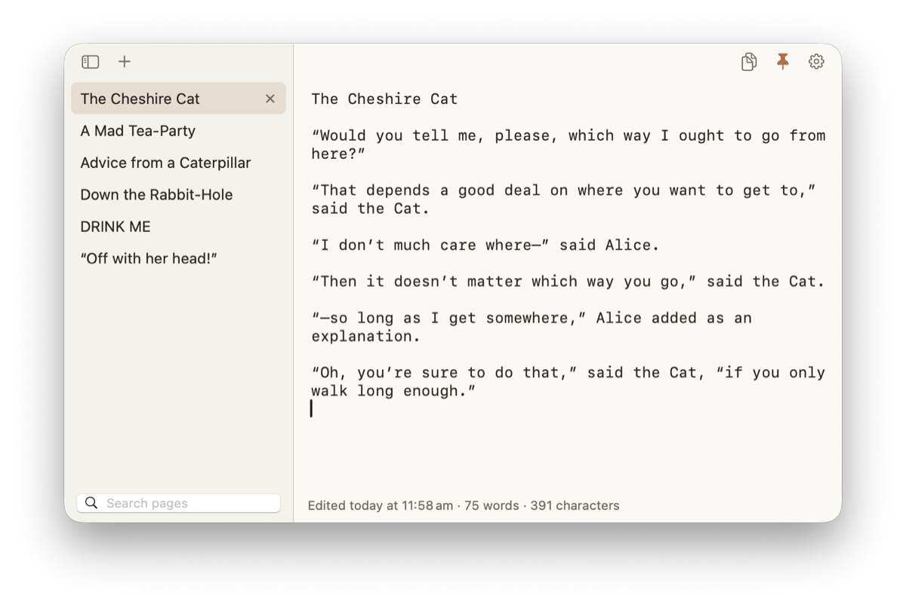

# Scratchbar

A tiny menu bar scratchpad for macOS. Plain-text pages that save as you type,
optional iCloud Drive sync between Macs, and local backups.

<p align="center"></p>

<p align="center"></p>

<p align="center"></p>

## Using it

- **Click the menu bar icon** to open or close the window. **Right-click** it for New Page, Settings… and Quit.
- **⌃⌥⌘N** (changeable) opens a new page from anywhere, ready to type or paste.
  Press it again, or Esc, to close.
- Pasting always gives plain text. Pages are named from their first line.
- **Copy** (the two-sheets icon, top right, or ⇧⌘C) copies the whole page. **Delete** (the ✕ on a
  sidebar row, or ⌘⌫) asks first, then moves it to the Trash.
- An empty page is thrown away when you leave it.
- **Pin** (top right) keeps the window on screen; unpinned it closes when you click elsewhere.
- ⌘+ / ⌘− / ⌘0 change the text size. ⌘F finds.
- ⌘[ / ⌘] go to the previous / next page in the list. ⇧⌘F (or the field under the list)
  searches the text of every page and highlights the matches in the open page.
- The page list can be dragged wider or narrower, or hidden with the sidebar button (⌃⌘S).
- The bottom line shows when the page was last edited, plus its word and character count.
- In the delete prompt, ⌘D (or Return) deletes.

**Settings** (the cog, ⌘,, or right-click on the icon › Settings…):
- General: Launch at login, Color scheme (System / Light / Dark), Text size, Stay on screen, Reset to default size.
- Keyboard: the global shortcut (default ⌃⌥⌘N) and a list of in-app shortcuts.
- iCloud: Sync with iCloud Drive, sync status, Show in Finder.
- Backups: browse and restore earlier versions, including deleted pages.
- About.

### URL scheme

```
open "scratchbar://new?text=Hello%20world"        # new page, window opens on it
open -g "scratchbar://new?text=Hello%20world&hide"  # new page, window stays closed
```

Text must be URL-encoded and at most 1 MB.

## Where things live

| What | Where |
|---|---|
| Pages (sync off) | `~/Library/Application Support/Scratchbar/Pages/` |
| Pages (sync on) | iCloud Drive › Scratchbar |
| Saved here while iCloud is unavailable | `~/Library/Application Support/Scratchbar/Pending/` |
| Backups (never synced) | `~/Library/Application Support/Scratchbar/Backups/` |

Each page is an ordinary UTF-8 `.txt` file, so you can read it with any editor.

If iCloud Drive can't be written, pages are saved on this Mac instead; the menu bar icon
shows a warning until they've been moved into iCloud (retried every minute and on wake).

## Building

Requires Xcode (Swift 6) on macOS 14 or later.

```bash
swift test                    # core tests
scripts/make-app.sh           # build/Scratchbar.app, signed with Developer ID
scripts/make-app.sh --install # also copy to /Applications
```

Set `SIGN_ID` to sign with a different identity.

## Memory

Measured with `footprint` on macOS 27.2 (Apple Silicon), 2026-11-19:

| State | Footprint |
|---|---|
| Just launched, window closed | 16 MB |
| Window open | 24 MB |
| After adding 10 more pages | 24 MB |
| After opening Settings (stays there until quit) | 34–35 MB |

Opening Settings once costs about 13 MB that is kept until you quit: the window
itself is freed when it closes, but AppKit keeps the toolbar, table and popup
code it loaded, and malloc keeps the freed pages around the objects still in use.
Opening it again doesn't add more.
| Window closed again | 25 MB |
| Reminders MenuBar, same Mac, same time (for comparison) | 100 MB |

## Licence

MIT — see [LICENSE](LICENSE).
