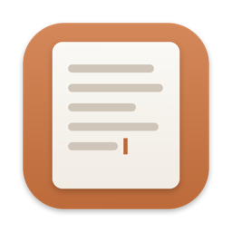
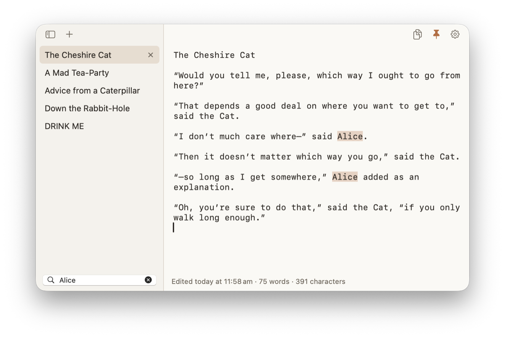
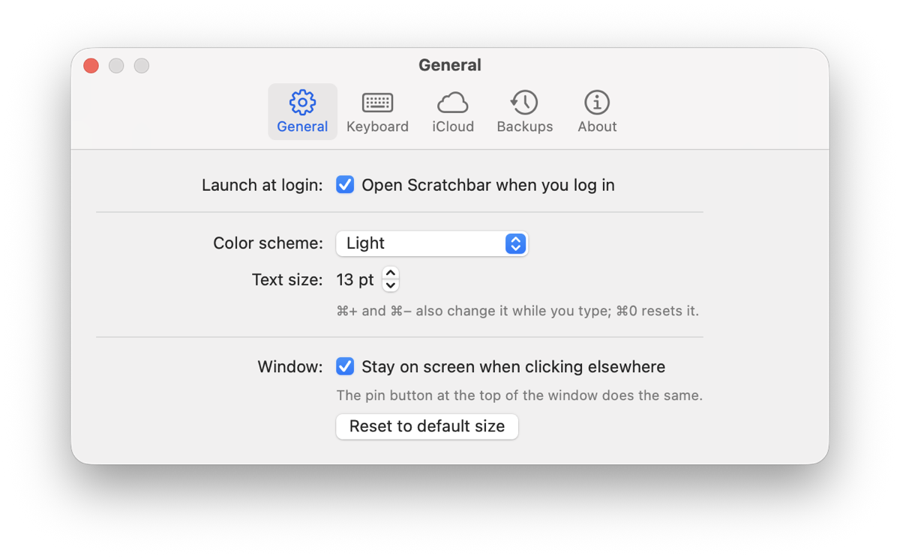

# Scratchbar

A plain-text scratchpad that lives in your Mac's menu bar.

Somewhere to paste a command, a snippet or a note you need for the next few minutes or
weeks, without opening an editor, naming a file or remembering to save.

<p align="center"></p>

- **Always one click away.** Click the menu bar icon, or press **⌃⌥⌘N** from any app,
  and start typing into a new page.
- **Plain text, always.** Whatever you paste arrives as plain text, with no fonts, colours
  or links.
- **Saved as you type.** There's no Save. Pages are kept until you delete them.
- **Named for you.** Each page takes its name from its first line.
- **Search everything.** Find text across every page, with matches highlighted.
- **Optional iCloud sync** between your Macs, plus local backups of every page.
- **Light.** About 16 MB of memory at launch, and around 25 MB once you've used it.

## Install

Scratchbar needs a Mac with Apple silicon and macOS 14 or later.

1. Download **Scratchbar-x.y.z.zip** from the
   [latest release](https://github.com/geraint360/scratchbar/releases/latest).
2. Open the zip and drag **Scratchbar** into your Applications folder.
3. Open it. Its icon appears in the menu bar.

Scratchbar is signed and notarised by Apple, so it opens without warnings. It starts
automatically when you log in; you can turn that off in Settings.

To update, quit Scratchbar (right-click the icon, then Quit) and replace it with the
new version. Your pages aren't touched.

### Building from source

You'll need Xcode.

```bash
git clone https://github.com/geraint360/scratchbar.git
cd scratchbar
SIGN_ID=- scripts/make-app.sh --install
```

`SIGN_ID=-` signs it for your own Mac only.

## Using it

**Opening and closing.** Click the icon to open the window and click it again to close
it. Right-click the icon for New Page, Settings… and Quit.

**Pages.** Press ⌘N or click **+** for a new page. A page you leave empty is thrown away.
To delete a page, click the **✕** on it in the list, then confirm. Right-click a page
in the list to duplicate, save a copy of, share or delete it.

**Sharing.** The share button (top right) sends the page to another app, such as
DEVONthink, Mail or Notes, as a `.txt` file named after the page.

**Pinning.** By default the window tucks away when you click elsewhere, like a menu.
It also closes with Esc. Click the pin to keep it on screen instead: you can then move
and resize it, and it stays where you put it.

**Searching.** Type in the field under the page list (or press ⇧⌘F). The list narrows to
the pages containing your text, and every match is highlighted. Press Return to jump
into the first match.

<p align="center"></p>

**The page list.** Drag its edge to make it wider or narrower, or hide it with the button
at the top left.

### Keyboard shortcuts

| Shortcut | |
|---|---|
| ⌃⌥⌘N | New page from anywhere (change it in Settings) |
| ⌘N | New page |
| ⇧⌘C | Copy the whole page |
| ⌘D | Duplicate the page |
| ⌘S | Save a copy as a `.txt` file |
| ⌘⌫ | Delete the page (⌘D confirms) |
| ⌘[ / ⌘] | Previous / next page |
| ⇧⌘F | Search all pages |
| ⌘F | Find in this page |
| ⌘+ / ⌘− / ⌘0 | Bigger / smaller / default text size |
| ⌃⌘S | Show or hide the page list |
| ⌘, | Settings |
| ⌘W | Close the window (Esc too, when it isn't pinned) |

## Settings

Click the cog or press ⌘, to open Settings.

- **General:** launch at login, light or dark appearance, text size and window size.
- **Keyboard:** change or turn off the ⌃⌥⌘N shortcut.
- **iCloud:** sync pages between your Macs.
- **Backups:** see earlier versions of any page and restore one. This includes pages you've deleted.

<p align="center"></p>

## Your pages

Each page is an ordinary text file, so you can always get at your text without
Scratchbar.

- **On this Mac:** `~/Library/Application Support/Scratchbar/Pages/`
- **With iCloud sync on:** iCloud Drive › Scratchbar

If iCloud isn't available, Scratchbar keeps saving on your Mac and catches up later. A
warning on the menu bar icon tells you while it's waiting. Backups stay on your Mac
and are kept for 30 days after a page is deleted.

## Automation

Make a page from a script, Shortcuts or another app:

```bash
open "scratchbar://new?text=Hello%20world"        # new page, window opens on it
open -g "scratchbar://new?text=Hello%20world&hide"  # new page, window stays closed
```

The text must be URL-encoded and is limited to 1 MB.

## Development

```bash
swift test              # run the tests
scripts/make-app.sh     # build build/Scratchbar.app
```

To make a release, bump the version in `Resources/Info.plist` and run
`scripts/release.sh --publish`. It builds, notarises and staples the app, then
uploads the zip to a new GitHub release. The script explains the one-time
notarisation setup.

For demos and testing, `open build/Scratchbar.app --args -dataFolder ~/some/folder`
runs Scratchbar on a separate folder, leaving your own pages alone.

## Licence

MIT — see [LICENSE](LICENSE).
